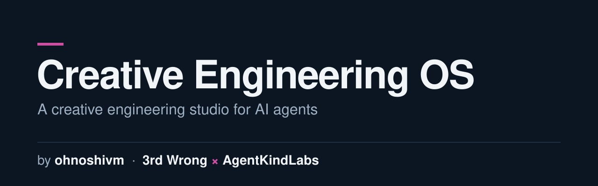
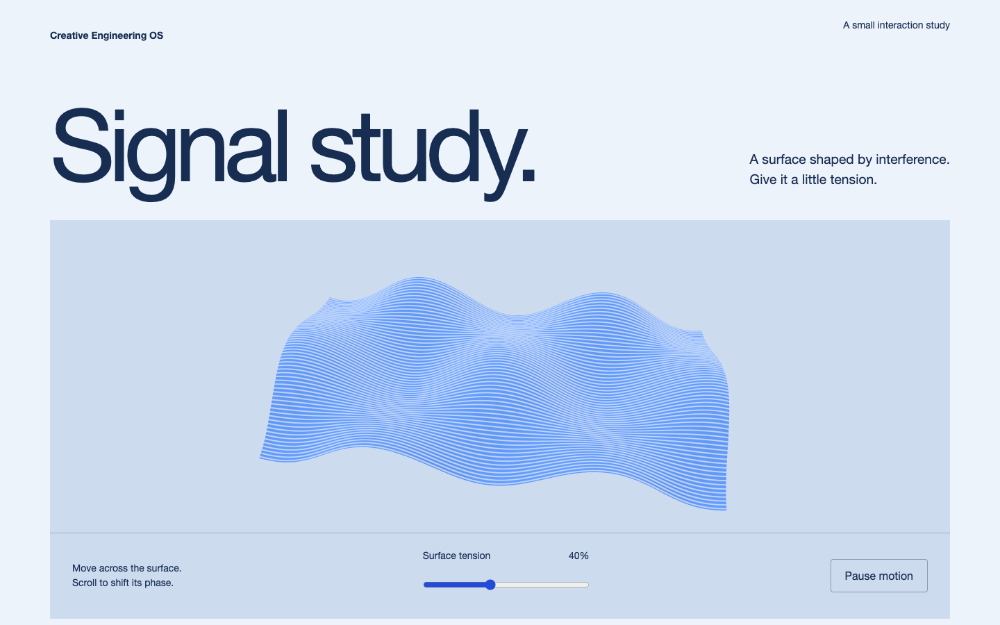

# Creative Engineering OS



Built by **ohnoshivm** — with **3rd Wrong** (design) × **AgentKindLabs** (AI & agents).

A portable creative development studio for AI coding agents: **14 core studio skills, a 386-skill on-demand library, four production-tested starters, graphics and motion examples, browser QA tooling, a Claude Code plugin and a complete ecosystem catalogue.**

It connects research, art direction, UX, typography, GSAP motion, Three.js/GLSL, asset production, independent visual criticism and release verification. Choose a concept and the smallest stack that serves it; this is a toolkit, not a promise that every generated site is world-class.

New here? Read [START-HERE.md](START-HERE.md) first. Agents can use [llms.txt](llms.txt) as a machine-readable index.



## The skill library

`library/` holds 386 third-party reference skills with their upstream licence files: official impeccable, the GSAP skills, taste-skill (`design-taste-frontend`), ui-ux-pro-max, Emil Kowalski's motion skills, interface-design, playwright-cli and superpowers. They are pinned to upstream commits and are **not auto-loaded**; open only the one a task needs. Browse [library/CATALOG.md](library/CATALOG.md) by discipline. A further 484 skills are listed in [library/UPSTREAM.md](library/UPSTREAM.md) with their sources; they are not redistributed here.

## Install the full bundle

macOS is the tested host. Use Python 3.11+, Node 22.22.0+, npm, Git, zsh, rsync and Google Chrome. [Prerequisites and setup](docs/INSTALL.md).

```sh
git clone https://github.com/ohnoshivm/creative-engineering-os.git ~/creative-engineering-os
cd ~/creative-engineering-os
python3 scripts/ceos.py doctor
python3 scripts/ceos.py install --client all --mcp          # review plan
python3 scripts/ceos.py install --client all --mcp --apply  # add owned links/server
python3 scripts/ceos.py dependencies --apply               # npm ci in six workspaces
```

Select `--client claude`, `codex`, `opencode` or `antigravity` for one client. Existing links/config entries are preserved; before-copies of changed config files stay private on the receiving machine. No account, model routing, paid plan or global instruction file is changed. Restart the client to load new capabilities.

## Claude Code plugin

For Claude-only use, install from the included marketplace instead of adding manual Claude skill links:

```text
/plugin install creative-engineering-os --marketplace ohnoshivm/creative-engineering-os
```

Then start with `/creative-engineering-os:ceos-studio-workflow`. The plugin loads skills, the independent auditor and isolated Chrome DevTools MCP. Full templates/tooling are included in the checkout; follow [plugin usage](docs/PLUGINS.md) to resolve its root and install project dependencies. Do not enable a second manual copy of the same Claude skills/MCP. Other clients use the portable installer; this is not a universal plugin format.

## Make your next website

```sh
./scripts/new-project.sh editorial ~/Projects/my-original-site
cd ~/Projects/my-original-site
npm ci
npm run dev
```

Choose `editorial` (Astro/type), `motion-heavy` (GSAP/Lenis), `immersive-3d` (Three.js/GSAP) or `experimental-graphics` (raymarching/feedback GLSL). Agree the concept, prototype the signature moment, then build, inspect and refine. [Usage and workflow](docs/USE.md).

## What is in the bundle?

- Original studio skills, independent auditor, standards, ownership/handoff rules and review reports.
- Four starters with pinned dependencies/lockfiles, responsive examples, reduced-motion/fallback paths and browser tests.
- Original Signal study demo, asset pipeline smoke test, capture/axe/console and frame-probe tools.
- Credential-free Chrome DevTools MCP configurations for four clients.
- Wider installed ecosystem manifests: skill names/hashes/provenance, plugin records, ten configured MCP integration names and tool versions. See [ecosystem catalogue](docs/ECOSYSTEM.md).

**Third-party plugins/skills, desktop binaries and account-bound servers are catalogued, not silently copied or relicensed.** Install them from their publishers where provenance permits. Unknown/private/local sources are marked. Credentials, subscriptions, caches, node_modules, personal agent/provider configs, database state and private backups are excluded. [Third-party notices](THIRD_PARTY_NOTICES.md) · [security and boundaries](docs/SECURITY.md).

## Verify and maintain

```sh
./scripts/verify.sh
python3 tests/scripts.test.py
python3 tests/installer.test.py
node --test tests/mirror.test.mjs
# Inside a starter/demo:
npm run build
npm test
npm run test:visual
```

The original local system passed five production builds, 92 browser smoke checks and 20 visual comparisons. New installer/export/plugin tests and fresh-clone validation are recorded in [release verification](docs/RELEASE-VALIDATION.md). Local measurements are not physical-device, Safari or field-CWV certification.

[Install](docs/INSTALL.md) · [Use](docs/USE.md) · [Plugin](docs/PLUGINS.md) · [System](SYSTEM.md) · [Skills](skills/ceos-studio-workflow/SKILL.md) · [Team](docs/AGENT-TEAM.md) · [Reference library](references/README.md)

## Made by

- **ohnoshivm** (Shivam) is the author and maintainer of Creative Engineering OS. [shivam.lol](https://shivam.lol) · [GitHub](https://github.com/ohnoshivm)
- **3rd Wrong** is a design company, and contributed a large part of the toolkit, mainly the design and art-direction side. [Instagram](https://instagram.com/3rdwrong)
- **AgentKindLabs** is an AI and agents company, and contributed a large part of the toolkit, mainly the agent, skills and automation side. [Instagram](https://instagram.com/agentkindlabs)

Follow: [X @ohnoshivm](https://x.com/ohnoshivm) · [Instagram @ohnoshivm](https://instagram.com/ohnoshivm) · [@3rdwrong](https://instagram.com/3rdwrong) · [@agentkindlabs](https://instagram.com/agentkindlabs) · [shivam.lol](https://shivam.lol)

Credits and third-party notes: [CREDITS.md](CREDITS.md).

MIT for original bundle content; upstream software keeps its own licenses. Download a versioned archive and checksum from [Releases](https://github.com/ohnoshivm/creative-engineering-os/releases).
